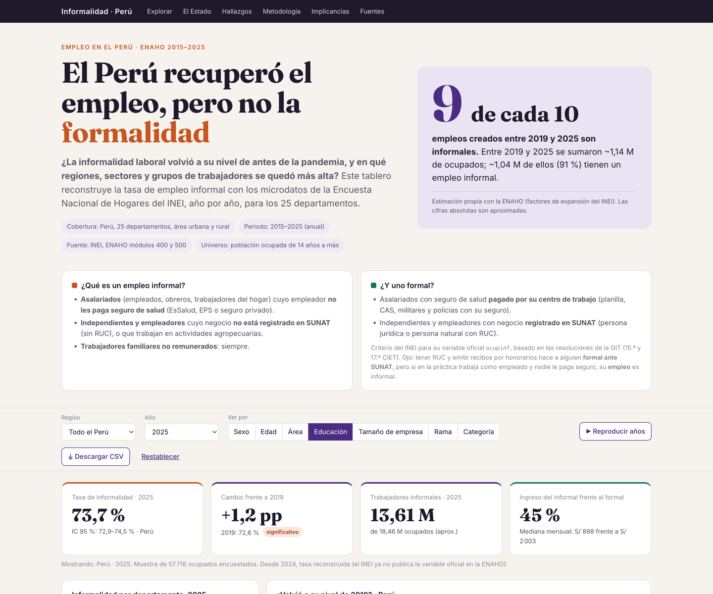
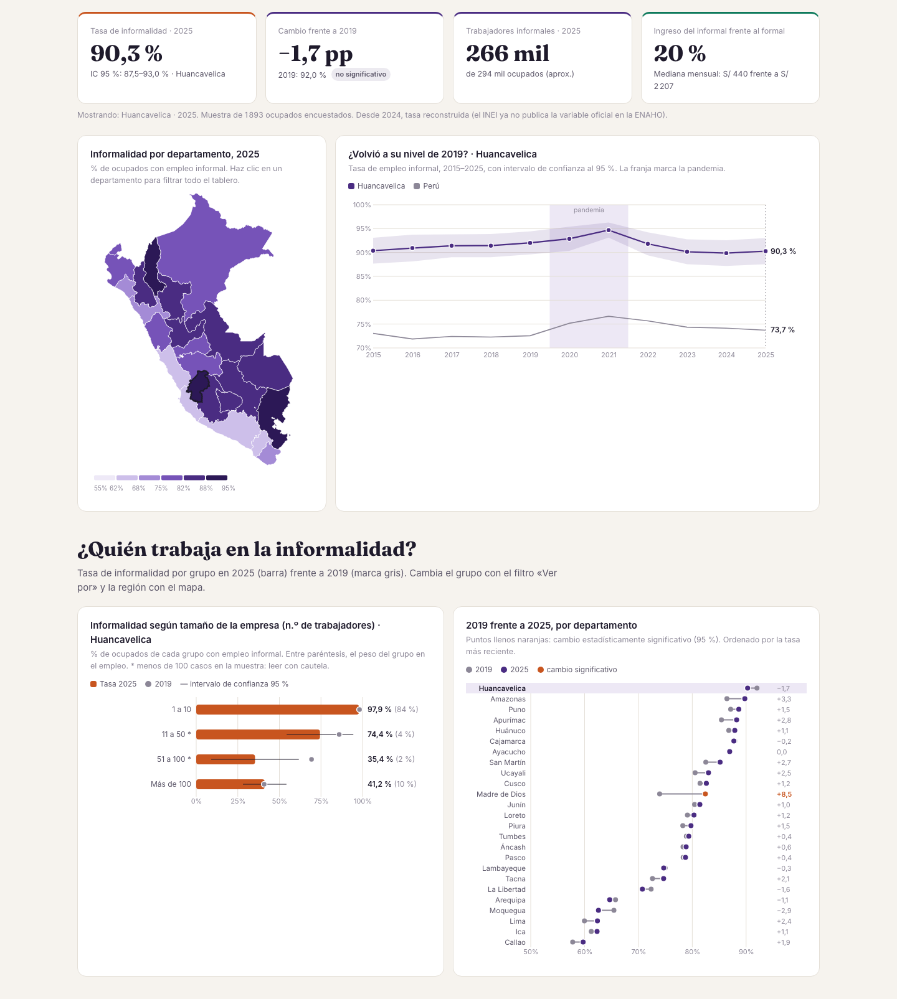

# El Perú recuperó el empleo, pero no la formalidad

**Tarea 3 · Python Intermedio · Isabella Albarrán**  
Diplomado en Ciencia de Datos para las Ciencias Sociales y la Gestión Pública 2026 (Q-LAB PUCP)

| | |
|---|---|
| **Dashboard público** | https://isabellaach.github.io/python-qlab/tarea_3/web/ |
| **Publicación de LinkedIn** | https://lnkd.in/p/daBRgWEP |
| **Reel** | [`reel/salidas/reel.mp4`](reel/salidas/reel.mp4) |

## 1. Tema y pregunta de investigación

**Informalidad laboral en el Perú, 2015–2025.**

> ¿La informalidad laboral volvió a su nivel de antes de la pandemia, y en qué regiones, sectores y grupos de trabajadores se quedó más alta?

Cobertura: Perú, 25 departamentos, área urbana y rural. Periodo: 2015–2025, anual. Universo: población ocupada de 14 años a más.

## 2. Descripción

Reconstruí la tasa de empleo informal **persona por persona** con los microdatos de la Encuesta Nacional de Hogares (ENAHO) del INEI, para 11 años y 25 departamentos. La comparé por sexo, edad, área, educación, tamaño de empresa, rama, categoría ocupacional e ingresos, con intervalos de confianza que respetan el diseño muestral. Los resultados se presentan en un dashboard interactivo y en un reel de 60 segundos.




## 3. Fuentes y metodología

**Fuentes**
- INEI, [ENAHO, microdatos 2015–2025](https://proyectos.inei.gob.pe/microdatos/), módulo 500 (empleo e ingresos) y módulo 400 (salud). Los descargué el 1/11/2026 con `scripts/obtener_datos.py`.
- IPE en ProActivo, [informalidad ENAHO 2019 (72,7 %) frente a EPEN](https://proactivo.com.pe/ipe-informalidad-laboral-en-el-pais-supero-el-73-en-el-ultimo-ano/): contraste con la cifra oficial de 2019.
- Gestión, [informalidad 2024 según la EPEN](https://gestion.pe/economia/informalidad-en-peru-cayo-pero-en-10-ciudades-la-situacion-fue-otra-como-entenderlo-empleo-en-peru-puestos-de-trabajo-inei-mercado-laboral-noticia/) (70,9 %), solo como contraste.
- Límites departamentales: geojson simplificado del INEI usado en el curso.
- Fotos (ilustrativas): Diego Delso, [puesto de comida en el Jr. Áncash, Lima](https://commons.wikimedia.org/wiki/File:Puesto_de_comida,_calle_Jir%C3%B3n_Ancash,_Lima,_Per%C3%BA,_2015-07-28,_DD_80.JPG) (CC BY-SA 4.0), y Elia Granados Solís, [cosecha de paltas en Aguar-Caujul, región Lima](https://commons.wikimedia.org/wiki/File:Cosecha_de_paltas.jpg) (CC BY-SA 4.0), ambas de Wikimedia Commons.
- Música del reel: [Atmospheric Documentary – leberch](https://pixabay.com/music/ambient-atmospheric-documentary-626200/) (licencia de contenido de Pixabay).

**¿Qué es un empleo informal?** Uso el criterio del INEI para su variable oficial `ocupinf`, basado en la 15.ª y la 17.ª CIET de la OIT:
- **Asalariados** (empleados, obreros, trabajadores del hogar): son informales si su empleador no les paga seguro de salud (EsSalud, EPS o seguro privado). Los militares y policías con el seguro de las FF.AA./PNP son formales.
- **Independientes y empleadores:** son informales si el negocio no está registrado en SUNAT (sin RUC) o si trabajan en actividades agropecuarias.
- **Trabajadores familiares no remunerados:** siempre informales.

Tener RUC y emitir recibos por honorarios hace a alguien formal **ante SUNAT**. Pero si en la práctica trabaja como empleado y nadie le paga seguro, su **empleo** es informal. Así ocurre con los locadores de servicios del Estado: la variable oficial los clasificaba como informales en un 98–100 %.

**Pasos**
1. `scripts/obtener_datos.py` descarga los módulos 400 y 500 de 2015 a 2025.
2. `scripts/procesar_datos.py`:
   - Une los dos módulos por vivienda, hogar y persona.
   - Filtra a los ocupados (`ocu500 = 1`).
   - Reconstruye la informalidad.
   - Calcula tasas ponderadas con `fac500a` e IC 95 % por linealización (conglomerados `conglome`, estratos departamento × `estrato`).
   - Calcula medianas de ingreso y el cambio 2019–2025 con su prueba de significancia (|dif| > 1,96 × EE).
3. Escribe las salidas en `datos/procesados/*.csv` y `web/data/datos.json`.

**Validación.** El INEI publicó `ocupinf` en la ENAHO **hasta 2023; desde 2024 ya no aparece ni en la base ni en el diccionario oficial**. Desde 2022, el INEI publica la informalidad con otra encuesta, la EPEN. Por eso reconstruí la variable para toda la serie y la validé así:

| Año | Coincidencia con `ocupinf` | Tasa oficial | Tasa reconstruida |
|---|:-:|:-:|:-:|
| 2015–2022 | 99,5–99,7 % | 72,1–76,8 % | −0,05 a −0,23 pp de la oficial |
| 2023 | 98,9 % | 73,9 % | 74,4 % |
| 2024 / 2025 | — | no publicada | 74,1 % / 73,7 % |

La tasa de 2019 calculada con `ocupinf` (72,7 %) coincide con la cifra oficial difundida para ese año. La tabla completa está en `datos/procesados/validacion_informalidad.csv`.

## 4. Hallazgos principales

1. **La informalidad no volvió a su nivel prepandemia.**
   - Era 72,6 % en 2019, llegó a un pico de 76,6 % en 2021 y está en **73,7 % en 2025** (IC 95 %: 72,9–74,5). La diferencia con 2019, +1,2 pp, es significativa, aunque por poco.
   - De los ~1,14 millones de empleos que se sumaron entre 2019 y 2025, ~1,04 millones son informales: **9 de cada 10**.
2. **Se informaliza el empleo que debería ser formal.**
   - El 78 % de los nuevos asalariados no tiene seguro pagado por su empleador.
   - La informalidad sube entre los asalariados (54,2 → 57,4 %), los universitarios (40,5 → 44,8 %) y en las empresas de más de 100 trabajadores (19,2 → 23,5 %).
   - Entre los **asalariados del Estado** sube de 21,0 % a 28,5 %. El 82 % de ellos trabaja por **locación de servicios**.
   - Todos estos cambios son significativos.
3. **Es un problema urbano con una brecha territorial enorme.**
   - Todo el aumento neto de informales es urbano: la tasa urbana pasa de 66,2 % a 68,4 %, mientras la rural se mantiene en torno a 95 %.
   - En 2025 la tasa va del 59,7 % del Callao al 90,3 % de Huancavelica. 13 de los 25 departamentos superan el 80 %.
   - Madre de Dios es el único con un aumento significativo (+8,5 pp).

**Otros hallazgos**
- **Ingresos:** en 2025, la mediana del ingreso mensual es S/ 898 para un informal y S/ 2 003 para un formal. La brecha se redujo: el informal ganaba el 37 % de lo que gana un formal en 2019 y el 45 % en 2025.
- **Género:** la brecha entre mujeres y hombres se cerró porque subió la informalidad de los hombres, no porque bajara la de las mujeres.

## 5. Limitaciones

- **ENAHO y EPEN no son comparables.** El 70,9 % que el INEI difundió para 2024 viene de la EPEN, otra encuesta con otro diseño. Mi 74,1 % viene de la ENAHO.
- En 2023 la reconstrucción sobreestima la tasa oficial en 0,4 pp. Si ese sesgo se mantiene en 2024–2025, el aumento frente a 2019 estaría más cerca de 0,8 pp.
- En 2020 parte de la ENAHO se levantó por teléfono, así que su comparabilidad es menor.
- Los conteos absolutos dependen de las proyecciones de población del INEI y no llevan intervalo de confianza.
- Por departamento y por grupo las muestras son menores. Los cambios pequeños no son concluyentes.
- El análisis es descriptivo: no identifica causas.

## 6. Enlaces

- Dashboard: https://isabellaach.github.io/python-qlab/tarea_3/web/. Los filtros se pueden compartir por URL, por ejemplo `?reg=09&anio=2025&dim=tamano`.
- LinkedIn: https://lnkd.in/p/daBRgWEP

## 7. Cómo reproducir

```bash
# desde la raíz del repo del curso (Data-Science-Python), con su .venv
cd tarea_3
python scripts/obtener_datos.py        # ~380 MB de microdatos del INEI → datos/originales/
python scripts/procesar_datos.py       # validación + indicadores → datos/procesados/ y web/data/datos.json
cd web && python -m http.server 8765   # dashboard en http://localhost:8765

# reel (entorno aparte)
cd reel
uv venv .venv --python 3.12
uv pip install --python .venv/bin/python qwen-tts faster-whisper pillow imageio-ffmpeg soundfile jiwer num2words
.venv/bin/python capturas.py           # imágenes del dashboard (con el servidor local encendido)
.venv/bin/python hacer_reel.py --voz recursos/mi_voz.m4a --texto-voz recursos/texto_voz.txt \
    --musica recursos/musica.mp3 --credito-musica "Atmospheric Documentary – leberch (Pixabay)"
```

**Estructura**

| Ruta | Contenido |
|---|---|
| `scripts/obtener_datos.py` | Descarga de la ENAHO |
| `scripts/procesar_datos.py` | Reconstrucción, validación, indicadores e IC |
| `datos/procesados/` | CSV de resultados (serie nacional, departamentos, grupos, ingresos, Estado, validación) |
| `web/` | Dashboard (HTML + D3, sin servidor): mapa de nivel y de cambio, filtros compartibles por URL, descarga CSV, vista previa para redes |
| `reel/guion.json` | Guion revisado, con la fuente de cada cifra |
| `reel/hacer_reel.py`, `reel/capturas.py` | Producción del reel |
| `reel/salidas/` | `reel.mp4`, `reel.srt`, `portada.png` |

Los microdatos originales, mi grabación de voz y la pista de música no se suben al repositorio (ver `.gitignore`).

## 8. Uso de inteligencia artificial

Desarrollé este proyecto con **Claude Code** (Anthropic): descarga y procesamiento de datos, reconstrucción y validación de la variable de informalidad, diseño y código del dashboard, y producción del reel. Yo definí la pregunta, el enfoque y el diseño, y revisé el guion y las interpretaciones. La narración del reel es **mi voz clonada con Qwen3-TTS** a partir de una grabación propia; los subtítulos se alinean con Whisper. Verifiqué las cifras contra la variable oficial del INEI (2015–2023).
