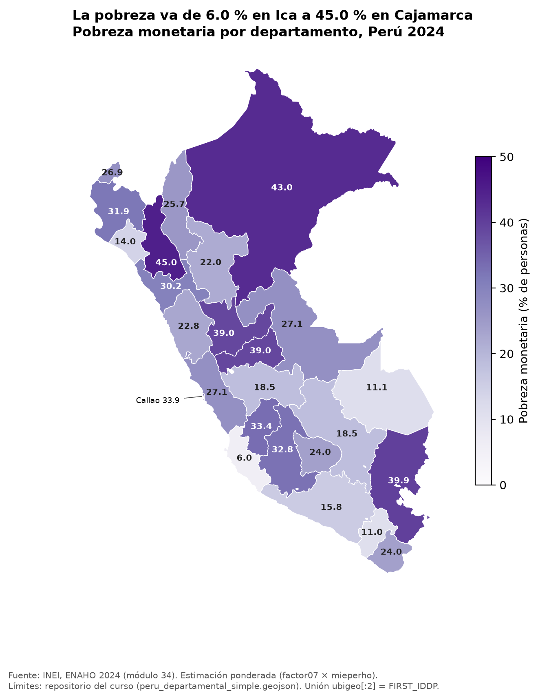
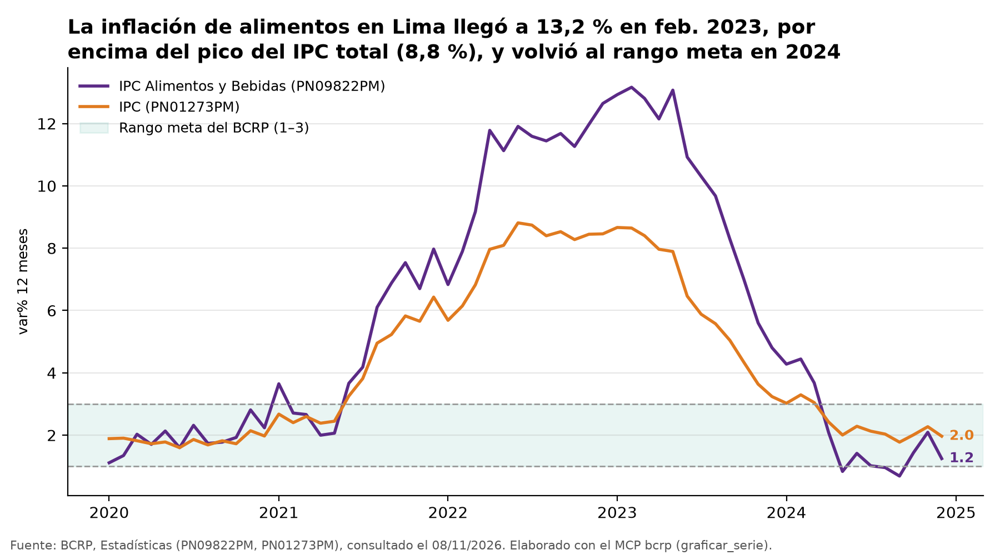

# Tarea 4: agente de investigación socioeconómica con MCP, skills y datos oficiales del Perú

Un agente en Claude Code que responde preguntas socioeconómicas del Perú con datos oficiales y trazables:

- **Precios y macroeconomía:** un servidor MCP propio sobre la API del BCRP.
- **Pobreza monetaria:** tres skills que limpian, grafican y mapean la ENAHO 2024 del INEI.

> **Pregunta de investigación.** ¿Cuánto subieron los precios de los alimentos en Lima entre 2021 y 2024 frente a
> la inflación general, y qué departamentos, áreas y grupos de población tenían más pobreza monetaria en 2024?

**Respuesta corta** ([informe completo](informes/informe_final.md)):

- **Precios:** entre dic. 2021 y dic. 2024, el índice de **alimentos y bebidas** de Lima Metropolitana subió
  **19,53 %**, frente a **14,17 %** del **IPC total** (BCRP, PN39445PM y PN38705PM). La inflación a 12 meses de
  alimentos llegó a 13,16 % en feb. 2023.
- **Pobreza en 2024:** fue de **27,6 %**, con estas brechas:
  - Área: 39,3 % en la rural frente a 24,8 % en la urbana.
  - Departamentos: de 45,0 % en Cajamarca a 6,0 % en Ica.
  - Edad: 36,5 % en niñas, niños y adolescentes.
  - Sexo: casi sin diferencia entre hombres y mujeres.



## 1. Objetivo

Construir y evaluar un agente que:

- consulte series del BCRP mediante un servidor MCP;
- procese la ENAHO 2024 con skills que validan antes de calcular;
- combine ambas fuentes en un informe reproducible, con cada cifra trazable a una herramienta o archivo;
- mida, en una evaluación de 10 preguntas, si el MCP y las skills mejoran las respuestas frente al modelo solo.

## 2. Arquitectura

```text
            pregunta en lenguaje natural
                        │
                ┌───────▼────────┐
                │  Claude Code   │  (agente: planifica, llama herramientas, escribe el informe)
                └──┬──────────┬──┘
     MCP (stdio)   │          │  skills (.claude/skills/)
   ┌───────────────▼──┐   ┌───▼───────────────────────────────────────────────┐
   │ mcp/server.py    │   │ limpiando-enaho → graficando-enaho                 │
   │ FastMCP · bcrp   │   │                 → mapeando-enaho                   │
   │ buscar_series    │   │ (scripts Python con uv; validan antes de calcular) │
   │ serie · resumen  │   └───┬───────────────────────────────────────────────┘
   │ graficar_serie   │       │ datos/966-Modulo34.zip, 966-Modulo02.zip, GeoJSON
   └──┬───────────────┘       ▼
      ▼                 salidas/ (validacion.txt, indicadores.csv) · figuras/ · mapas/
  API del BCRP                 │
      └───────────────┬────────┘
                      ▼
          informes/informe_final.md  →  evaluacion/ (modo A sin herramientas vs. modo B con ellas)
```

```text
tarea_4/
├── README.md · pyproject.toml · uv.lock · .mcp.json · .gitignore
├── mcp/            server.py, test_server.py (8 pruebas originales), test_propias.py (2 propias)
├── .claude/skills/ limpiando-enaho/ · graficando-enaho/ · mapeando-enaho/
├── scripts/        descargar_datos.sh
├── datos/          microdatos y GeoJSON (ignorado por git)
├── salidas/        validacion.txt · indicadores.csv · comparacion_mapa_referencia.csv
├── figuras/ · mapas/
├── evaluacion/     preguntas.csv · evaluar.py · resultados.csv · comparacion.md
├── informes/       informe_final.md · verificacion.md · instruccion_agente.md
└── evidencias_ia/  mcp/ · skills/ · integracion/ · evaluacion/ · desarrollo/
```

## 3. Herramientas del MCP (`mcp/server.py`, servidor `bcrp`)

El servidor parte del de la Sesión 04 (FastMCP 4).

| Tipo | Nombre | Qué hace |
|---|---|---|
| Herramienta | `buscar_series(texto, frecuencia, limite)` | Busca códigos en el catálogo del BCRP (sin tildes, por palabras) |
| Herramienta | `serie(codigo, desde, hasta)` | Devuelve los datos de una serie con periodos normalizados (`2025-01`, `2025-T1`, `2026-10-15`, `2025`), la URL de la API y la página web |
| Herramienta | `resumen(codigo, desde, hasta)` | Primero y último dato, cambio, variación %, promedio, máximo y mínimo con su periodo, y fuente |
| **Herramienta propia** | `graficar_serie(codigo, desde, hasta, comparar_con, lineas_referencia, ...)` | Guarda en `figuras/` un PNG con 1 o 2 series, la banda de referencia (p. ej., el rango meta de 1 % a 3 %), el último valor anotado y la nota de fuente con la fecha de consulta. Devuelve la ruta, el resumen de cada serie y las URLs |
| Recurso | `bcrp://serie/{codigo}` | Ficha de la serie en JSON: nombre, grupo, frecuencia, fechas, página web y ejemplo de la API |
| Prompt | `informe(tema)` | Plantilla de informe: buscar → resumir → graficar → 3 hallazgos con código, periodo y URL, sin afirmar causalidad |

Si un código o una fecha no son válidos, o el BCRP no responde, las herramientas lanzan `ToolError` con el motivo y
la URL; nunca devuelven datos vacíos como si fueran válidos.

**Pruebas:** `uv run pytest` da **10 passed**. Son las 8 pruebas originales de la Sesión 04 (sin cambios) y 2
propias de `graficar_serie`: que guarde un PNG real con la fuente y la cifra correctas, y que falle con un mensaje
claro.

## 4. Skills (`.claude/skills/`)

| Skill | Se activa cuando piden… | Qué hace | Salida |
|---|---|---|---|
| `limpiando-enaho` | limpiar, unir o validar la ENAHO, o una cifra de pobreza de 2024 | Lee los módulos 34 y 02 desde los zip; filtra residentes habituales; hace la unión m:1 (sin duplicar); construye área, departamento (`ubigeo[:2]`), sexo y edad; calcula la pobreza ponderada; corre **19 verificaciones** y **se detiene (exit 1)** si falla una esencial | `salidas/validacion.txt`, `salidas/indicadores.csv`, parquets |
| `graficando-enaho` | graficar o comparar la pobreza por área, sexo, edad o departamento | Barras ponderadas desde cero, en un solo color, con valores escritos, la línea nacional, título analítico y fuente | `figuras/pobreza_*_2024.png` |
| `mapeando-enaho` | un mapa o la distribución territorial de la pobreza | Coroplético unido por código (`ubigeo[:2]` = `FIRST_IDDP`), con 25 unidades (Lima y Callao separados), comparado con la referencia de la Sesión 16 | `mapas/pobreza_departamento_2024.png`, `salidas/comparacion_mapa_referencia.csv` |

**Encadenamiento.** `graficando-enaho` y `mapeando-enaho` revisan si existen las bases limpias. Si no existen, llaman
primero a `limpiando-enaho` y siguen solo si la validación dice `VÁLIDO`. Esto se ve en
`evidencias_ia/skills/01_demo_skills_claude_code.md`: `Skill(mapeando-enaho)` → `Skill(limpiando-enaho)`.

**Validación ENAHO 2024** (`salidas/validacion.txt`, **19/19 aprobadas**):

| Verificación | Resultado | Referencia |
|---|---|---|
| Pobreza nacional | 27,58 % (método INEI); 27,53 % (personas, `facpob07`) | 27,6 % ± 0,1 |
| Residentes habituales | 108 664 | 108 664 |
| Unidades territoriales | 25/25 (Lima 15 y Callao 07 separados) | 25 |
| Unión personas–hogares | m:1, 108 664 antes y después, 0 sin hogar | sin duplicar |
| Ponderación | ponderado 27,53 % frente a 25,61 % sin ponderar | ponderado |
| 25 departamentos frente a la Sesión 16 | 25/25 coinciden; diferencia máxima 0,05 pp | ± 0,1 pp |

**Decisión de ponderación.**

- Las cifras territoriales (nacional, área, departamento y Lima Metropolitana) usan el método oficial del INEI: la
  sumaria con `factor07 × mieperho`.
- Las cifras por características individuales (sexo y edad) usan a los residentes del módulo 02 con `facpob07`.
- Con `facpob07`, Lima Metropolitana daba 28,03 % (frente a 28,2 % oficial) y Puno se alejaba 0,52 pp de la
  referencia; con el método del INEI, todas las cifras quedan a 0,05 pp o menos.
- Ver `.claude/skills/limpiando-enaho/reference.md`.

## 5. Fuentes de datos

| Fuente | Qué se usa | Enlace |
|---|---|---|
| BCRP, BCRPData | Series mensuales del IPC de Lima Metropolitana (PN38705PM, PN39445PM, PN01273PM, PN09822PM) y las de la evaluación | API: `https://estadisticas.bcrp.gob.pe/estadisticas/series/api/{codigo}/json/{desde}/{hasta}` · web: <https://estadisticas.bcrp.gob.pe/estadisticas/series/> |
| INEI, ENAHO 2024 (código 966) | Módulo 34 (sumaria, 33 691 hogares) y módulo 02 (miembros, 117 721 filas) | <https://proyectos.inei.gob.pe/microdatos/> (descarga: `https://proyectos.inei.gob.pe/iinei/srienaho/descarga/STATA/966-Modulo34.zip` y `966-Modulo02.zip`) |
| Límites departamentales | `peru_departamental_simple.geojson` (25 unidades, `FIRST_IDDP`) | [repositorio del curso, sesión 06](https://github.com/d2cml-ai/Data-Science-Python/tree/main/sessions/06-geoespacial/lab/Data) |
| Referencias oficiales | Pobreza 2024 nacional, por área y por departamento (INEI) | enunciado del [issue #201](https://github.com/d2cml-ai/Data-Science-Python/issues/201) y Sesión 16 |

Los microdatos **no se suben** al repositorio (`datos/` está en `.gitignore`); se descargan con el script.

## 6. Instalación con uv

Requisitos: [uv](https://docs.astral.sh/uv/) y [Claude Code](https://claude.com/claude-code).

```bash
git clone https://github.com/isabellaach/python-qlab.git
cd python-qlab/tarea_4
uv sync                          # Python, fastmcp, pandas, geopandas, matplotlib, pytest
bash scripts/descargar_datos.sh  # ENAHO 2024 (módulos 34 y 02) y GeoJSON en datos/
```

## 7. Conexión del MCP

`.mcp.json` registra el servidor en el ámbito del proyecto. También registra `fetch`, que no se usó en el informe
ni en la evaluación.

```json
{"mcpServers": {"bcrp": {"type": "stdio", "command": "uv", "args": ["run", "mcp/server.py"]}}}
```

1. Abre `claude` dentro de `tarea_4/` y acepta el servidor del proyecto.
2. En `/mcp` debe aparecer `bcrp · connected` con las 4 herramientas (`evidencias_ia/mcp/00_mcp_herramientas.png`).
3. El prompt se usa como `/mcp__bcrp__informe` y el recurso como `bcrp://serie/PN01273PM`.

Equivalente sin el archivo: `claude mcp add --scope project bcrp -- uv run mcp/server.py`.

## 8. Comandos para reproducir

```bash
uv run pytest                                                    # 10 passed
uv run .claude/skills/limpiando-enaho/scripts/limpiar.py         # validacion.txt + indicadores.csv (19/19)
uv run .claude/skills/graficando-enaho/scripts/graficar.py --tipo todos
uv run .claude/skills/mapeando-enaho/scripts/mapear.py           # 25/25 departamentos
uv run evaluacion/evaluar.py                                     # 20 sesiones claude -p → resultados.csv
```

El informe se reproduce abriendo `claude` en `tarea_4/` y pegando la instrucción de `informes/instruccion_agente.md`.

## 9. Resultados de la evaluación

Detalle en [`evaluacion/comparacion.md`](evaluacion/comparacion.md) y [`evaluacion/resultados.csv`](evaluacion/resultados.csv).

**Diseño:**

- **10 preguntas:** 4 del BCRP, 4 de la ENAHO y 2 mixtas.
- **Respuestas esperadas verificadas fuera del agente:** web y API del BCRP, y cifras del INEI. Quedaron fijadas
  en el commit `d358924` antes de correr la evaluación, con su tolerancia.
- **20 sesiones independientes** de `claude -p` con Sonnet:
  - Modo A: sin herramientas, sin MCP, sin skills y desde una carpeta vacía.
  - Modo B: con el MCP `bcrp`, las skills, Read y Bash limitado, y prohibido leer `evaluacion/` e `informes/`.

| | Sin MCP ni skills (A) | Con MCP y skills (B) |
|---|---|---|
| Correctas | **0/10** | **10/10** |
| Incorrectas | 2 | 0 |
| Sin respuesta | 8 | 0 |
| Tiempo promedio | 5,0 s | 9,3 s |

**Lectura de los resultados:**

- **Modo A:** sin herramientas, el modelo casi siempre reconoce que no sabe. Las 2 veces que respondió de memoria
  se equivocó, con cifras de pobreza que suenan oficiales (26,1 % urbana y 27,8 % Lima Metropolitana).
- **Modo B:** con herramientas acierta todas y cita el código de la serie o el archivo. A cambio, tarda casi el
  doble y cuesta unas 6 veces más.

## 10. Limitaciones y problemas encontrados

**Alcance:**

- Las series de precios son de **Lima Metropolitana**; la pobreza es **nacional** y de un solo año (2024).
- El informe pone ambas cosas lado a lado; **no estima una relación causal** entre los precios y la pobreza.
- La ENAHO es una encuesta: las cifras tienen error muestral, que no se reporta. Los departamentos con muestras
  pequeñas son menos precisos.

**Problemas encontrados en el desarrollo:**

- **Ponderación.** El primer cálculo, con `facpob07` para todo, no reproducía Lima Metropolitana ni Puno. Se
  resolvió con el método del INEI en las cifras territoriales (sección 4).
- **Ranking de `buscar_series`.** «ipc indice dic.2021» no devolvía el índice del IPC total entre los 5 primeros
  resultados. Agregué al docstring un ejemplo de búsqueda («indice de precios al consumidor dic.2021») y con eso el
  agente lo encuentra.
- **Recurso MCP con `@`.** En Claude Code, adjuntar el recurso con `@bcrp:bcrp://serie/...` no entregó el contenido.
  Pedirle al agente «lee el recurso MCP bcrp://serie/...» sí funcionó (`ReadMcpResource`); ver
  `evidencias_ia/mcp/`.
- **Servidores y skills.** Se cargan al iniciar la sesión: después de cambiar `server.py` o un `SKILL.md` hay que
  abrir una sesión nueva.
- **Límites del BCRP.** Cuando limita las consultas, o si el código no existe, el BCRP responde con HTML en vez de
  JSON. El servidor reintenta 4 veces y luego lanza un `ToolError` con la URL.
- **Evaluación, modo B.** En las preguntas de la ENAHO, el agente leyó las salidas validadas de las skills
  (`salidas/`) en vez de volver a invocarlas. La invocación y el encadenamiento de las skills se ven en la demo de
  skills y en la ejecución integrada.

**Evaluación:** son solo 10 preguntas, una corrida y un solo modelo.

## 11. Ejemplo de una ejecución completa

Está en [`evidencias_ia/integracion/01_ejecucion_integrada.md`](evidencias_ia/integracion/01_ejecucion_integrada.md):
es una sola sesión de Claude Code que recibió la instrucción de `informes/instruccion_agente.md`.

1. **Plan:** qué series del BCRP y qué indicadores de la ENAHO necesita.
2. **MCP:** `buscar_series` ×3 → `resumen` sobre PN38705PM, PN39445PM, PN01273PM y PN09822PM → `graficar_serie`
   (alimentos frente al IPC total, 2020–2024, con el rango meta) → `figuras/informe_bcrp_inflacion_alimentos.png`.
3. **Skills:** `Skill(limpiando-enaho)` (validación 19/19) → `Skill(graficando-enaho)` (`--tipo todos`) →
   `Skill(mapeando-enaho)` (25/25).
4. **Informe:** escribe [`informes/informe_final.md`](informes/informe_final.md) con las 7 secciones, 5 hallazgos y
   una tabla de trazabilidad de cada cifra.
5. **Verificación manual:** revisé 14 cifras del informe, 7 del BCRP y 7 de la ENAHO, en
   [`informes/verificacion.md`](informes/verificacion.md); las 14 coinciden con la fuente oficial.



## 12. Evidencias del uso de IA

Todo el trabajo se hizo con Claude Code (Claude Opus 5.5 y, en la evaluación, Sonnet). Antes de publicar las
conversaciones las sanitizé: la ruta personal se reemplazó por `~` y se quitaron el correo y los recordatorios
internos del sistema. No contienen claves ni tokens.

| Carpeta | Contenido |
|---|---|
| [`evidencias_ia/mcp/`](evidencias_ia/mcp/) | Captura de `/mcp` con las 4 herramientas; demo de las herramientas, el recurso y el prompt |
| [`evidencias_ia/skills/`](evidencias_ia/skills/) | Captura de `/skills`; demo de activación en lenguaje natural y encadenamiento |
| [`evidencias_ia/integracion/`](evidencias_ia/integracion/) | Ejecución integrada completa (pregunta → MCP + skills → informe) |
| [`evidencias_ia/evaluacion/`](evidencias_ia/evaluacion/) | Las 20 conversaciones de la evaluación (`modo_A/`, `modo_B/`, en JSONL), con las herramientas habilitadas y usadas |
| [`evidencias_ia/desarrollo/`](evidencias_ia/desarrollo/) | Conversación de desarrollo de la tarea (servidor, pruebas, skills, evaluación) y transcripciones completas de las demos |
