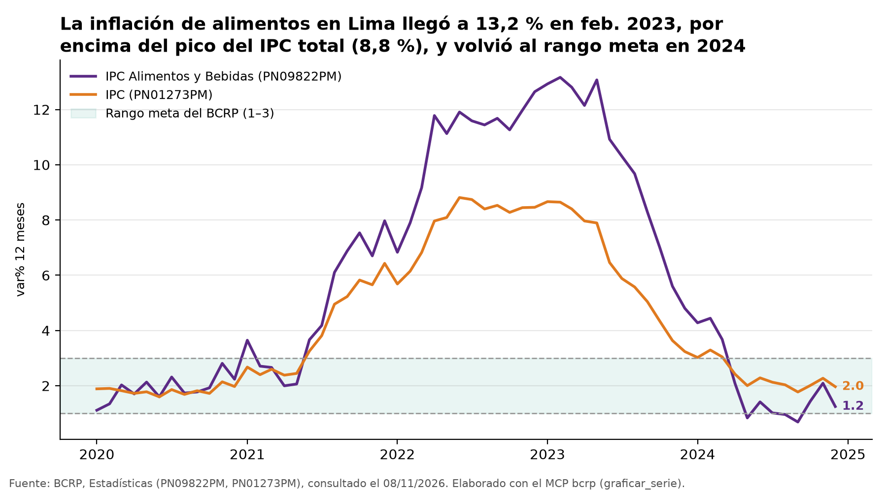
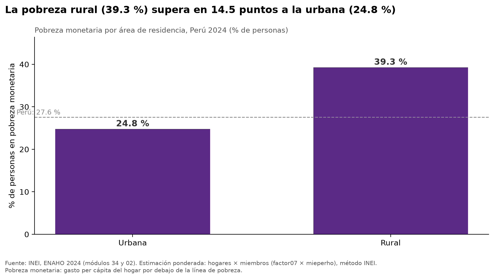
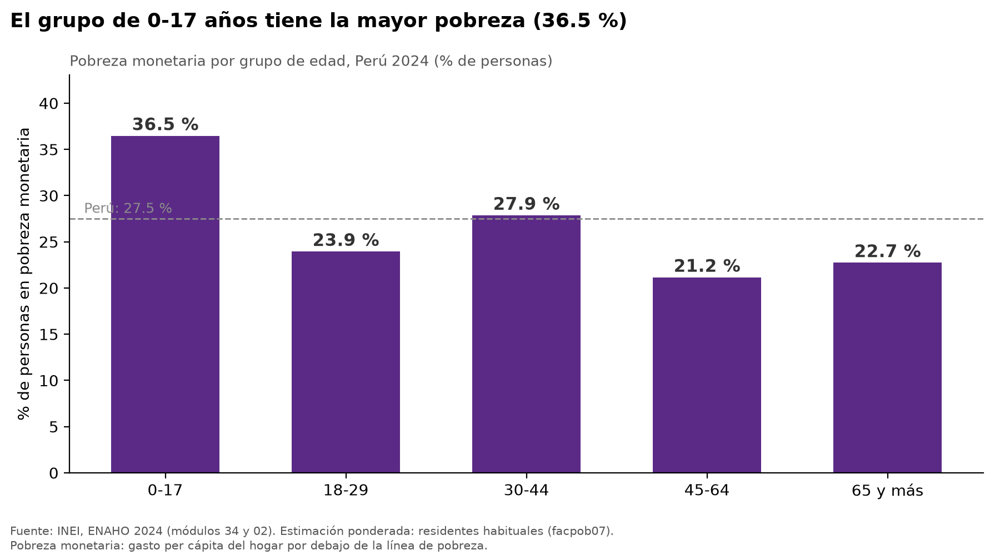
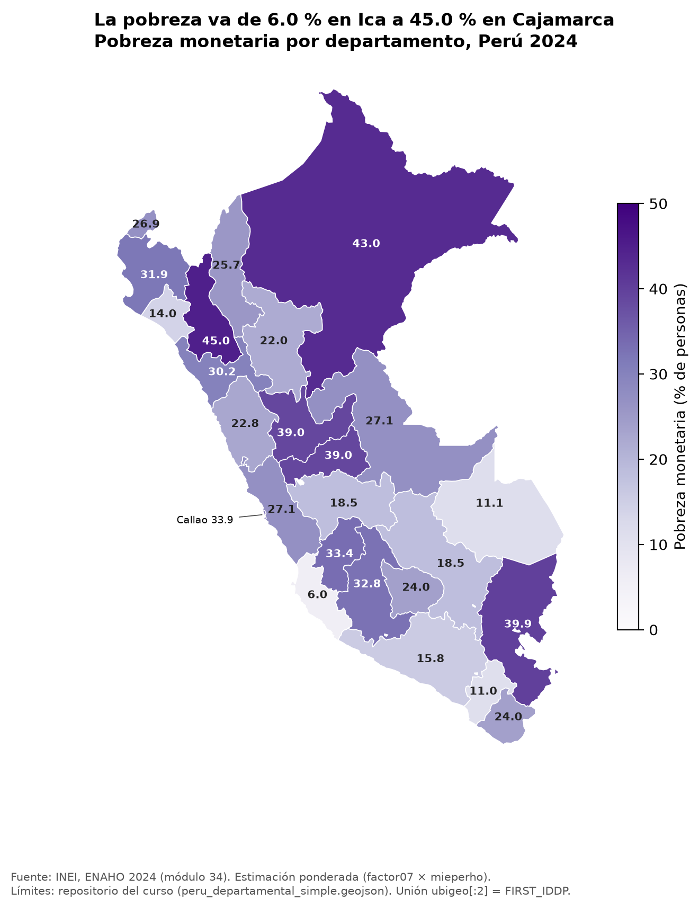

# Precios de los alimentos en Lima (2021–2024) y pobreza monetaria en el Perú (2024)

Informe elaborado el 8 de noviembre de 2026 por un agente de investigación (Claude Code). Las cifras vienen del MCP
`bcrp` y de las skills `limpiando-enaho`, `graficando-enaho` y `mapeando-enaho`. No se calculó ni se escribió de
memoria ningún número: cada uno está en la tabla «Trazabilidad de cifras» al final.

## 1. Pregunta de investigación

**Tema.** El costo de los alimentos y la pobreza monetaria en el Perú después del choque inflacionario de 2022–2023.

**Pregunta.** ¿Cuánto subieron los precios de los alimentos en Lima entre 2021 y 2024 frente a la inflación general,
y qué departamentos, áreas y grupos de población tenían más pobreza monetaria en 2024?

**Objetivo.** Describir, con datos oficiales, (a) el alza acumulada de los precios de alimentos y bebidas frente al
IPC total en Lima Metropolitana y la trayectoria de la inflación a 12 meses, y (b) dónde y en qué grupos se concentra
la pobreza monetaria en 2024.

**Delimitación.**

- Precios: Lima Metropolitana, datos mensuales. La variación acumulada va de diciembre de 2021 a diciembre de 2024
  (índices con base dic. 2021 = 100). La inflación a 12 meses se revisa de enero de 2020 a diciembre de 2024.
- Pobreza: Perú, año 2024 (ENAHO 2024). Se desagrega por área (urbana y rural), los 25 departamentos (Lima y Callao
  por separado), el dominio Lima Metropolitana, sexo y grupo de edad.
- Las dos partes se presentan juntas, pero **no** se estima una relación causal entre precios y pobreza.

## 2. Fuentes y metodología

### Banco Central de Reserva del Perú (BCRP), mediante el MCP `bcrp`

Encontré las series con `buscar_series`. Calculé todas las cifras con `resumen` y armé el gráfico con `graficar_serie`.

| Código | Serie | Uso |
|---|---|---|
| PN38705PM | Índice de precios Lima Metropolitana (índice dic. 2021 = 100), IPC | Variación acumulada del IPC total |
| PN39445PM | Índice de precios Lima Metropolitana (índice dic. 2021 = 100), IPC Alimentos y Bebidas | Variación acumulada de alimentos y bebidas |
| PN01273PM | Índice de precios Lima Metropolitana (var. % 12 meses), IPC | Inflación a 12 meses total, pico y nivel final |
| PN09822PM | Índice de precios Lima Metropolitana (var. % 12 meses), IPC Alimentos y Bebidas | Inflación a 12 meses de alimentos, pico y nivel final |

Fuente: BCRP, Estadísticas (BCRPData). Consulta del 8 de noviembre de 2026. Según `buscar_series`, las series se
actualizaron por última vez el 8 de octubre de 2026.

### INEI, Encuesta Nacional de Hogares (ENAHO) 2024, mediante las skills

- **Módulos:** 34 (sumaria: `sumaria-2024.dta`, con 33 691 hogares) y 02 (características de los miembros del hogar:
  `enaho01-2024-200.dta`, con 117 721 filas). Código de la ENAHO 2024 en el portal del INEI: 966.
- **Unidad:** residentes habituales (108 664 personas en la muestra). La unión de personas con hogares es m:1, sin
  duplicar ni perder registros.
- **Definiciones:** pobre si `pobreza` ≤ 2; pobre extremo si `pobreza` = 1. La clasificación es la del INEI: gasto
  per cápita del hogar frente a la línea de pobreza. Urbano si `estrato` ≤ 5. Lima Metropolitana si `dominio` = 8.
  Departamento según `ubigeo[:2]`.
- **Ponderación:**
  - Indicadores territoriales (nacional, área, departamento y Lima Metropolitana): sumaria con `factor07 × mieperho`.
    Es el método oficial del INEI.
  - Indicadores individuales (sexo y edad): base de personas con `facpob07`.
  - Todas las tasas son ponderadas; no hay promedios simples.
- **Indicadores:** tasa de pobreza monetaria y tasa de pobreza extrema, en % de personas.
- **Validación:** `salidas/validacion.txt` y `salidas/comparacion_mapa_referencia.csv` contrastan los resultados con
  las cifras oficiales de referencia.

## 3. Resultados

### Hallazgo 1. Entre dic. 2021 y dic. 2024, los alimentos subieron más que el IPC total en Lima

- El índice de **alimentos y bebidas** pasó de 100 (dic. 2021) a **119,53** (dic. 2024): una variación acumulada de
  **19,53 %** (PN39445PM, 2021-12 a 2024-12). Su máximo del periodo fue **120,75**, en agosto de 2024.
- El **IPC total** pasó de 100 a **114,17**: una variación acumulada de **14,17 %** (PN38705PM, 2021-12 a 2024-12).
  Su máximo también fue en agosto de 2024, con **114,32**.
- En promedio, durante el periodo el índice de alimentos estuvo en **114,25** y el IPC total en **109,47**.

### Hallazgo 2. La inflación de alimentos tuvo un pico más alto y más tardío, y volvió al rango meta a fines de 2024

- La inflación a 12 meses de **alimentos y bebidas** llegó a **13,16 %** en febrero de 2023 (PN09822PM, 2020-01 a
  2024-12). Su promedio de 2020 a 2024 fue **5,88 %**.
- La del **IPC total** llegó a **8,81 %** en junio de 2022 (PN01273PM, 2020-01 a 2024-12). Su promedio de 2020 a 2024
  fue **4,47 %**.
- En 2024 las dos bajaron:
  - Alimentos pasó de **4,28 %** en enero a **1,25 %** en diciembre. Tocó un mínimo de **0,69 %** en septiembre, por
    debajo del rango meta (PN09822PM, 2024-01 a 2024-12).
  - El IPC total pasó de **3,02 %** a **1,97 %**, con un mínimo de **1,78 %** en septiembre (PN01273PM, 2024-01 a
    2024-12).
  - En diciembre de 2024 ambas quedaron dentro del rango meta del BCRP (1 % a 3 %).

### Hallazgo 3. La pobreza rural es mayor que la urbana, sobre todo la extrema

- La pobreza monetaria nacional fue **27,58 %** y la pobreza extrema **5,50 %** (`salidas/indicadores.csv`, método
  INEI).
- En el **área rural**, la pobreza fue **39,30 %** y la pobreza extrema **15,52 %**. En el **área urbana** fueron
  **24,81 %** y **3,14 %** (`salidas/indicadores.csv`).
- Lima Metropolitana, el ámbito de las series de precios, tuvo **28,21 %** de pobreza y **3,28 %** de pobreza extrema
  (`salidas/indicadores.csv`, dominio = 8).

### Hallazgo 4. La pobreza se concentra en Cajamarca, Loreto, Puno, Pasco y Huánuco

Según `salidas/comparacion_mapa_referencia.csv`, ordenado de mayor a menor:

- **Mayor pobreza:**
  - **Cajamarca**: 45,01 %
  - **Loreto**: 42,97 %
  - **Puno**: 39,94 %
  - **Pasco**: 38,97 %
  - **Huánuco**: 38,96 %
- **Menor pobreza:**
  - **Ica**: 6,01 %
  - **Moquegua**: 10,97 %
  - **Madre de Dios**: 11,15 %
- **Pobreza extrema:** también es más alta en Cajamarca (**19,72 %**) y Loreto (**14,98 %**) (`salidas/indicadores.csv`).
- **Callao y Lima:** el Callao (**33,86 %**) supera al departamento de Lima (**27,07 %**).

### Hallazgo 5. Niñas, niños y adolescentes son el grupo de edad más pobre; por sexo las tasas son casi iguales

- **Por edad:**
  - **0 a 17 años**: **36,47 %** de pobreza y **8,13 %** de pobreza extrema.
  - **45 a 64 años**: **21,15 %**, la tasa más baja.
  - Los demás grupos: 18 a 29 años, **23,95 %**; 30 a 44 años, **27,87 %**; 65 años y más, **22,74 %**.
  - Fuente: `salidas/indicadores.csv`, con `facpob07`.
- **Por sexo:**
  - Hombres **27,37 %** y mujeres **27,68 %**. La diferencia es menor de 1 punto, así que son casi iguales.
  - Dentro de cada área: en el área rural, mujeres **40,04 %** y hombres **38,82 %**; en el área urbana, mujeres
    **24,83 %** y hombres **24,63 %**.
  - Fuente: salida de `graficando-enaho`, `--tipo todos`.

## 4. Visualizaciones

**Inflación a 12 meses: alimentos y bebidas frente al IPC total, Lima Metropolitana, 2020–2024.** Hecho con
`graficar_serie` del MCP `bcrp` (PN09822PM frente a PN01273PM), con la banda del rango meta de 1 % a 3 %.



El título del gráfico dice que la inflación «volvió al rango meta en 2024». Se refiere al cierre del año: en septiembre
de 2024, la inflación de alimentos estuvo por debajo de 1 % (Hallazgo 2).

**Pobreza monetaria por área, Perú 2024.** Hecho con la skill `graficando-enaho` (`--tipo area`).



**Pobreza monetaria por grupo de edad, Perú 2024.** Hecho con la skill `graficando-enaho` (`--tipo edad`).



**Mapa de la pobreza monetaria por departamento, Perú 2024.** Hecho con la skill `mapeando-enaho`, con los 25
departamentos unidos por código (`ubigeo[:2] = FIRST_IDDP`).



Otras figuras generadas en la misma corrida:

- `../figuras/pobreza_sexo_2024.png`
- `../figuras/pobreza_sexo_area_2024.png`
- `../figuras/pobreza_departamento_2024.png`

## 5. Interpretación

**Precios.** Entre diciembre de 2021 y diciembre de 2024, la canasta de alimentos y bebidas de Lima Metropolitana
se encareció más que el conjunto de bienes y servicios del IPC (19,53 % frente a 14,17 %).

El episodio inflacionario se notó más en los alimentos:

- Su inflación a 12 meses llegó a un pico más alto y más tardío (13,16 % en febrero de 2023, frente a 8,81 % del IPC
  total en junio de 2022).
- Su promedio de 2020 a 2024 también fue mayor.

En 2024 la inflación volvió al rango meta. Eso significa que los precios dejaron de subir rápido, no que bajaron: los
índices llegaron a su máximo en agosto de 2024 y cerraron el año cerca de ese nivel. El alza acumulada de los
alimentos sigue presente en el nivel de precios.

**Pobreza.** En 2024, poco más de un cuarto de la población era pobre (27,58 %). La pobreza no se reparte igual:

- Es mayor en el área rural (39,30 %) que en la urbana (24,81 %). La brecha es más marcada en la pobreza extrema.
- Es mayor en departamentos de la sierra y la selva (Cajamarca, Loreto, Puno, Pasco, Huánuco).
- Afecta más a menores de 18 años (36,47 %).
- No muestra diferencias relevantes entre hombres y mujeres.

Lima Metropolitana, donde se miden los precios del BCRP, tuvo una tasa de pobreza (28,21 %) parecida a la nacional.

**Lectura conjunta.** Los dos resultados describen el mismo periodo desde ángulos distintos: cuánto se encareció comer
en Lima y quiénes eran pobres en 2024. Los datos de este informe **no permiten** afirmar que el alza de los alimentos
causó la pobreza observada ni medir su efecto:

- Las fuentes tienen coberturas distintas.
- No hay un contrafactual.
- La pobreza depende también de los ingresos, el empleo y las transferencias, que no se analizan aquí.

Sí permiten describir el contexto. Los hogares pobres gastan su presupuesto frente a una línea de pobreza, y en estos
años el componente de alimentos subió más que el resto de precios.

## 6. Limitaciones

- **Cobertura geográfica de los precios:** el IPC del BCRP corresponde solo a Lima Metropolitana. No describe los
  precios de los departamentos con más pobreza (Cajamarca, Loreto, Puno), donde la inflación pudo ser distinta.
- **Cobertura temporal:**
  - Las series de precios son mensuales (2020–2024).
  - La ENAHO es un corte anual de 2024: no muestra cómo cambió la pobreza durante 2021–2024 ni su relación mes a mes
    con la inflación.
  - El informe no incluye la ENAHO de otros años; la skill está validada solo para 2024.
- **Distintas unidades:** las cifras de precios son índices y variaciones en %. Las de pobreza son % de personas.
  No son comparables directamente.
- **Calidad y precisión de los datos:**
  - Los indicadores de la ENAHO son estimaciones de una encuesta por muestreo. Las skills no calculan intervalos de
    confianza ni coeficientes de variación, así que el informe no reporta el error de muestreo.
  - Las estimaciones departamentales usan muestras menores. Por ejemplo, Madre de Dios tiene 603 hogares en
    `salidas/indicadores.csv`. Las diferencias pequeñas entre departamentos deben leerse con cautela.
- **Validación:**
  - Pasaron 19 de 19 verificaciones (`salidas/validacion.txt`).
  - Los 25 departamentos coinciden con la referencia con una diferencia máxima de 0,05 pp
    (`salidas/comparacion_mapa_referencia.csv`).
  - La pobreza nacional con `facpob07` (27,53 %) difiere levemente de la del método INEI (27,58 %) por la
    ponderación. Por eso los cruces individuales (sexo y edad) se comparan con 27,53 %.
- **Alcance de las conclusiones:** los hallazgos son descriptivos. No establecen causalidad entre la inflación de
  alimentos y la pobreza, ni explican por qué un departamento o grupo es más pobre.
- **Herramientas:** ninguna llamada al MCP ni a las skills falló o dejó de devolver datos.

## 7. Reproducibilidad

Todos los comandos se corren desde `tarea_4/`.

**Servidor MCP del BCRP.** En `.mcp.json`: `uv run mcp/server.py`. Las llamadas fueron:

```text
buscar_series("indice de precios al consumidor dic.2021", frecuencia="Mensual")   -> PN38705PM
buscar_series("dic.2021 alimentos y bebidas", frecuencia="Mensual")               -> PN39445PM
buscar_series("ipc 12 meses", frecuencia="Mensual", limite=20)                    -> PN01273PM, PN09822PM
resumen("PN38705PM", "2021-12", "2024-12")
resumen("PN39445PM", "2021-12", "2024-12")
resumen("PN01273PM", "2020-01", "2024-12")
resumen("PN09822PM", "2020-01", "2024-12")
resumen("PN01273PM", "2024-01", "2024-12")
resumen("PN09822PM", "2024-01", "2024-12")
graficar_serie("PN09822PM", "2020-01", "2024-12", comparar_con="PN01273PM",
               lineas_referencia=[1, 3], archivo="informe_bcrp_inflacion_alimentos.png",
               titulo="La inflación de alimentos en Lima llegó a 13,2 % en feb. 2023, ...")
```

**URLs del BCRP**, que devolvió la herramienta. Las de la API tienen la forma
`https://estadisticas.bcrp.gob.pe/estadisticas/series/api/<código>/json/<desde>/<hasta>`:

- https://estadisticas.bcrp.gob.pe/estadisticas/series/api/PN38705PM/json/2021-12/2024-12
- https://estadisticas.bcrp.gob.pe/estadisticas/series/api/PN39445PM/json/2021-12/2024-12
- https://estadisticas.bcrp.gob.pe/estadisticas/series/api/PN01273PM/json/2020-1/2024-12
- https://estadisticas.bcrp.gob.pe/estadisticas/series/api/PN09822PM/json/2020-1/2024-12
- https://estadisticas.bcrp.gob.pe/estadisticas/series/api/PN01273PM/json/2024-1/2024-12
- https://estadisticas.bcrp.gob.pe/estadisticas/series/api/PN09822PM/json/2024-1/2024-12
- Páginas web: https://estadisticas.bcrp.gob.pe/estadisticas/series/mensuales/resultados/PN38705PM/html/2021-12/2024-12/
  (y lo mismo con cada código y periodo)

**ENAHO, con las skills:**

```bash
bash scripts/descargar_datos.sh        # solo si faltan datos/966-Modulo34.zip, datos/966-Modulo02.zip o el geojson
uv run .claude/skills/limpiando-enaho/scripts/limpiar.py --anio 2024
uv run .claude/skills/graficando-enaho/scripts/graficar.py --tipo todos
uv run .claude/skills/mapeando-enaho/scripts/mapear.py
```

**Archivos de salida:**

- `salidas/validacion.txt`: resultado de las 19 verificaciones. Dice «VÁLIDO».
- `salidas/indicadores.csv`: indicadores nacionales, por área, dominio, departamento, sexo y edad.
- `salidas/comparacion_mapa_referencia.csv`: los 25 departamentos comparados con la referencia.
- `salidas/hogares_2024.parquet` y `salidas/personas_2024.parquet`: bases limpias.
- Figuras:
  - `figuras/informe_bcrp_inflacion_alimentos.png`
  - `figuras/pobreza_area_2024.png`
  - `figuras/pobreza_edad_2024.png`
  - `figuras/pobreza_sexo_2024.png`
  - `figuras/pobreza_sexo_area_2024.png`
  - `figuras/pobreza_departamento_2024.png`
  - `mapas/pobreza_departamento_2024.png`

## Trazabilidad de cifras

Los valores se redondearon a dos decimales en el texto. Esta tabla muestra el valor exacto que devolvió cada
herramienta. Para el BCRP, «URL API» es `https://estadisticas.bcrp.gob.pe/estadisticas/series/api/<código>/json/<periodo>`.

| Cifra en el informe | Valor | Herramienta o archivo | URL o ruta para comprobar |
|---|---|---|---|
| Índice alimentos y bebidas, dic. 2024 (base dic. 2021 = 100) | 119.5292 | MCP bcrp `resumen("PN39445PM","2021-12","2024-12")`, `ultimo` | URL API PN39445PM/json/2021-12/2024-12 |
| Variación acumulada de alimentos y bebidas, dic. 2021 a dic. 2024 | 19.5292 % | ídem, `variacion_pct` | ídem |
| Máximo del índice de alimentos (ago. 2024) | 120.7543 | ídem, `maximo` | ídem |
| Promedio del índice de alimentos, 2021-12 a 2024-12 | 114.2462 | ídem, `promedio` | ídem |
| Índice IPC total, dic. 2024 (base dic. 2021 = 100) | 114.1721 | MCP bcrp `resumen("PN38705PM","2021-12","2024-12")`, `ultimo` | URL API PN38705PM/json/2021-12/2024-12 |
| Variación acumulada del IPC total, dic. 2021 a dic. 2024 | 14.1721 % | ídem, `variacion_pct` | ídem |
| Máximo del índice IPC total (ago. 2024) | 114.322 | ídem, `maximo` | ídem |
| Promedio del índice IPC total, 2021-12 a 2024-12 | 109.474 | ídem, `promedio` | ídem |
| Pico de la inflación de alimentos a 12 meses (feb. 2023) | 13.1637 % | MCP bcrp `resumen("PN09822PM","2020-01","2024-12")`, `maximo` | URL API PN09822PM/json/2020-1/2024-12 |
| Promedio de la inflación de alimentos a 12 meses, 2020–2024 | 5.8843 % | ídem, `promedio` | ídem |
| Pico de la inflación total a 12 meses (jun. 2022) | 8.8126 % | MCP bcrp `resumen("PN01273PM","2020-01","2024-12")`, `maximo` | URL API PN01273PM/json/2020-1/2024-12 |
| Promedio de la inflación total a 12 meses, 2020–2024 | 4.4664 % | ídem, `promedio` | ídem |
| Inflación de alimentos a 12 meses, ene. 2024 | 4.2793 % | MCP bcrp `resumen("PN09822PM","2024-01","2024-12")`, `primero` | URL API PN09822PM/json/2024-1/2024-12 |
| Inflación de alimentos a 12 meses, dic. 2024 | 1.2481 % | ídem, `ultimo` | ídem |
| Mínimo de la inflación de alimentos a 12 meses (sep. 2024) | 0.6877 % | ídem, `minimo` | ídem |
| Inflación total a 12 meses, ene. 2024 | 3.0239 % | MCP bcrp `resumen("PN01273PM","2024-01","2024-12")`, `primero` | URL API PN01273PM/json/2024-1/2024-12 |
| Inflación total a 12 meses, dic. 2024 | 1.9663 % | ídem, `ultimo` | ídem |
| Mínimo de la inflación total a 12 meses en 2024 (sep. 2024) | 1.775 % | ídem, `minimo` | ídem |
| Rango meta del BCRP | 1 % a 3 % | Dato de la instrucción; dibujado con `graficar_serie(lineas_referencia=[1, 3])` | `figuras/informe_bcrp_inflacion_alimentos.png` |
| Pobreza nacional (método INEI) | 27.58 % | `salidas/indicadores.csv`, grupo Nacional | `salidas/indicadores.csv` |
| Pobreza extrema nacional | 5.5 % | `salidas/indicadores.csv`, grupo Nacional | ídem |
| Pobreza nacional con personas y `facpob07` | 27.53 % | `salidas/indicadores.csv`, grupo Nacional (personas) | ídem |
| Pobreza rural / extrema rural | 39.3 % / 15.52 % | `salidas/indicadores.csv`, Área Rural | ídem |
| Pobreza urbana / extrema urbana | 24.81 % / 3.14 % | `salidas/indicadores.csv`, Área Urbana | ídem |
| Pobreza / extrema en Lima Metropolitana | 28.21 % / 3.28 % | `salidas/indicadores.csv`, Dominio Lima Metropolitana | ídem |
| Pobreza en Cajamarca | 45.01 % | `salidas/comparacion_mapa_referencia.csv`, ccdd 06 | `salidas/comparacion_mapa_referencia.csv` |
| Pobreza en Loreto | 42.97 % | ídem, ccdd 16 | ídem |
| Pobreza en Puno | 39.94 % | ídem, ccdd 21 | ídem |
| Pobreza en Pasco | 38.97 % | ídem, ccdd 19 | ídem |
| Pobreza en Huánuco | 38.96 % | ídem, ccdd 10 | ídem |
| Pobreza en Callao | 33.86 % | ídem, ccdd 07 | ídem |
| Pobreza en el departamento de Lima | 27.07 % | ídem, ccdd 15 | ídem |
| Pobreza en Ica | 6.01 % | ídem, ccdd 11 | ídem |
| Pobreza en Moquegua | 10.97 % | ídem, ccdd 18 | ídem |
| Pobreza en Madre de Dios | 11.15 % | ídem, ccdd 17 | ídem |
| Diferencia máxima con la referencia departamental | 0.05 pp | `salidas/comparacion_mapa_referencia.csv` (Amazonas y Madre de Dios) y `salidas/validacion.txt` | ídem |
| Pobreza extrema en Cajamarca / Loreto | 19.72 % / 14.98 % | `salidas/indicadores.csv`, Departamento 06 y 16 | `salidas/indicadores.csv` |
| Muestra de Madre de Dios | 603 hogares | `salidas/indicadores.csv`, columna `muestra` | ídem |
| Pobreza / extrema en 0 a 17 años | 36.47 % / 8.13 % | `salidas/indicadores.csv`, Grupo de edad | ídem |
| Pobreza en 18 a 29 años | 23.95 % | ídem | ídem |
| Pobreza en 30 a 44 años | 27.87 % | ídem | ídem |
| Pobreza en 45 a 64 años | 21.15 % | ídem | ídem |
| Pobreza en 65 años y más | 22.74 % | ídem | ídem |
| Pobreza en hombres / mujeres | 27.37 % / 27.68 % | `salidas/indicadores.csv`, Sexo | ídem |
| Pobreza rural en mujeres / hombres | 40.04 % / 38.82 % | Salida de `graficar.py --tipo todos` (skill graficando-enaho) | `figuras/pobreza_sexo_area_2024.png` |
| Pobreza urbana en mujeres / hombres | 24.83 % / 24.63 % | ídem | ídem |
| Hogares en la sumaria | 33 691 | `salidas/validacion.txt` | `salidas/validacion.txt` |
| Filas del módulo 02 / residentes habituales | 117 721 / 108 664 | `salidas/validacion.txt` | ídem |
| Verificaciones aprobadas | 19 de 19 | `salidas/validacion.txt` | ídem |
| Fecha de la última actualización de las series del BCRP | 2026-10-08 | MCP bcrp `buscar_series`, campo `actualizada` | Respuesta de `buscar_series` |
