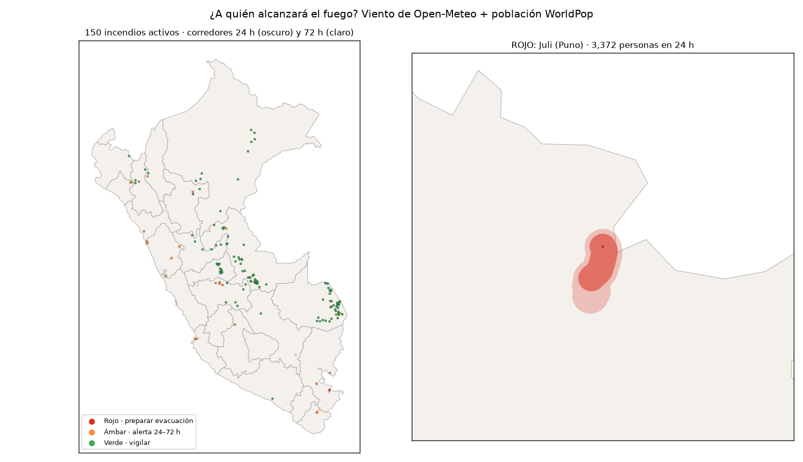
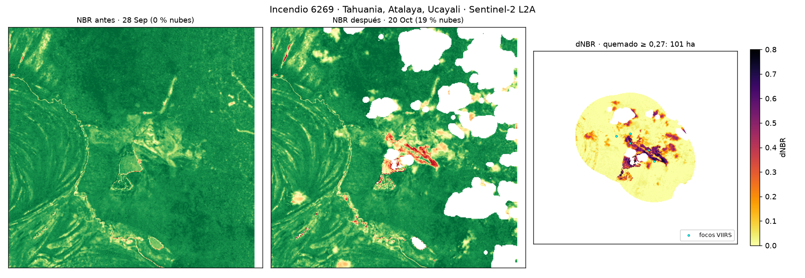

# ¿A quién alcanzará el fuego? Alerta de evacuación por incendios en el Perú (24–72 h)

Tarea de clase (Ciencia de Datos con Python, 21 oct 2026) · Reto propio que combina **F · Clima y riesgo** con **D · ¿A quién afecta?** y el dNBR obligatorio.

## La pregunta

> **¿Qué poblaciones del Perú deberían prepararse para evacuar en las próximas 24–72 h, según hacia dónde empujará el viento a los incendios activos de hoy?**

**Mejora frente al tablero de referencia:** ese tablero cuenta personas en un **círculo fijo de 5 km** alrededor del fuego, que mira al pasado y no tiene dirección. Aquí el área de riesgo es un **corredor que sigue al viento pronosticado** y se proyecta hacia el futuro, y termina en una decisión: un semáforo por incendio y una lista de distritos.

**¿Por qué 24–72 h?** 0–24 h es el plazo operativo para evacuar, y el satélite VIIRS pasa cada ~12 h, así que se puede verificar al día siguiente. 24–72 h sirve para la alerta temprana. Más allá de 72 h, el pronóstico de viento y humedad ya no es confiable para decidir una evacuación.

**Sitio web interactivo:** https://claude.ai/artifact/B6Xd7Qk5C5pGghCu1tjt68 (mapa, ranking, pronóstico hora a hora, distritos y dNBR). Dashboard local: `streamlit run app.py`.



## Datos y fechas

| Dato | Fuente | Tipo | Fecha |
|---|---|---|---|
| Focos de calor VIIRS (S-NPP, NOAA-20, NOAA-21) | NASA FIRMS, CSV «South America 7d» | Puntos | 14–21 oct 2026, corte **21 oct 19:19 UTC** |
| Pronóstico horario: viento, humedad, lluvia | Open-Meteo (sin clave) | Serie | desde **21 oct 20:00** (Lima) hasta +72 h |
| Población | WorldPop 2020, 1 km | **Raster** | 2020 |
| Cobertura del suelo | ESA WorldCover 10 m (Planetary Computer) | **Raster** | 2021 |
| Imágenes para dNBR | Sentinel-2 L2A (Planetary Computer) | **Raster** | pre **28 sep** (0 % nubes en la zona) · post **20 oct** (19 % nubes) |
| Límites | INEI, `juaneladio/peru-geojson` | Polígonos | — |

## Método (4 scripts, todo en CPU)

1. **`01_incendios_activos.py`**: une los 3 satélites y descarta los focos de confianza baja. Agrupa los focos a ≤ 1 km y ≤ 48 h en un **incendio**, que está **activo** si tiene al menos un foco en las últimas 24 h. La huella es el número de píxeles únicos de 375 m × 14 ha.
2. **`02_clima_exposicion.py`**:
   - **Fuentes fijas fuera:** focos en ≥ 4 de 7 días, o ≥ 50 % sobre suelo desnudo, urbano o agua según WorldCover. Así salen la planta de gas de Pisco, la fundición de Ilo, Siderperú en Chimbote, etc.
   - **Avance del fuego:** 10 % de la velocidad del viento (regla de Cruz y Alexander, 2019), multiplicado por un factor de sequedad (1 si HR ≤ 30 %, 0 si HR ≥ 70 %). Vale 0 si llueve ≥ 0,5 mm/h. El fuego avanza hacia donde **va** el viento.
   - **Corredor:** la trayectoria hora a hora, con un ancho del 25 % del avance, a 24, 48 y 72 h. Las personas dentro se suman con WorldPop.
   - **Semáforo (umbral 500 personas):** 🔴 si hay ≥ 500 personas en el corredor de 24 h **y** el fuego está confirmado (≥ 3 focos en 24 h o ≥ 50 ha). 🟠 si hay ≥ 500 en 72 h, o si un solo foco amenaza a ≥ 500 personas (verificar en campo). 🟢 en el resto.
3. **`03_dnbr.py <id>`**: dNBR con Sentinel-2. Mide el % de nubes **dentro de la zona** con la capa SCL y elige la imagen más clara antes y después del primer foco. NBR = (B08 − B12)/(B08 + B12). Cuenta como quemado un dNBR ≥ 0,27, solo a ≤ 1,5 km de focos VIIRS.
4. **`05_relieve_poblados.py`**: relieve con Copernicus DEM GLO-30 (Planetary Computer, **raster** de 30 m) y centros poblados de GeoNames alrededor de cada incendio en rojo o ámbar. Calcula a qué hora el corredor alcanzaría cada poblado, con la misma trayectoria hora a hora.
5. **`04_mapa.py`**: mapa estático. **`app.py`**: dashboard en Streamlit.



## Tres hallazgos

1. **De 161 incendios activos hoy, solo 1 justifica preparar una evacuación en 24 h: Juli (Puno).** Tiene 3 focos en 24 h, viento de hasta 20 km/h y humedad mínima de 32 %. Su avance estimado es de ~9 km hacia el sur-suroeste, y hay **3 372 personas en su corredor de 24 h** (5 793 en 72 h). El primer poblado en su camino sería **Suancata Cañi, en ~14 h** (luego Suancata Central y Suancata, entre 14 y 16 h). Otros **23 incendios quedan en alerta temprana (ámbar)**, con **56 distritos** en el camino del fuego. Se descartaron 11 "incendios" que eran fuentes fijas o suelo desnudo.
2. **La dirección del viento cambia a quién hay que avisar.** En Candarave (Tacna), con aire muy seco (HR 25 %) y sin lluvia, el corredor de 72 h tiene **1 641 personas**, contra **201** en el círculo fijo de 5 km (×8). En Ticapampa (Áncash) son **2 583 contra 254** (×10). En cambio, en La Banda de Shilcayo (San Martín) el viento aleja el fuego de Tarapoto: **1 309 contra 27 523**. El círculo fijo sobreestima en 142 de 150 incendios y subestima justo en los más secos y ventosos.
3. **El satélite térmico subestima el área quemada.** En Tahuania (Atalaya, Ucayali), el dNBR de Sentinel-2 mide **101 ha quemadas** (dNBR ≥ 0,27), frente a **70 ha de huella VIIRS** (+44 %). De ellas, **52 ha son de severidad moderada-alta o alta**.

## Limitaciones

- **Un foco de calor no es un incendio.** Muchos "ámbar" de la costa (Pisco, Chimbote, Virú) son **un solo foco**, probablemente quemas agrícolas. Por eso no llegan a rojo y se marcan para verificar en campo.
- **Las nubes esconden el fuego:** en la Amazonía, en octubre, VIIRS y Sentinel-2 pierden incendios. La imagen post del dNBR tiene 19 % de nubes enmascaradas.
- El avance es una **regla empírica**, no un simulador físico: no considera pendiente, tipo de combustible ni ataque de brigadas. La regla del 10 % fue calibrada para bosque y matorral secos.
- WorldPop es de 2020. El umbral de 500 personas y el ancho del corredor son **decisiones mías**, no estándares oficiales.
- **Sin validar** contra perímetros reales. El siguiente paso sería un backtest: ¿los incendios en rojo el día *d* fueron los que más crecieron en *d+2*?
- Herramienta académica: no reemplaza a INDECI, COEN, SERFOR ni SERNANP.

## Cómo correrlo

```bash
cd tarea_data_raster
python -m venv .venv && source .venv/bin/activate
pip install -r requirements.txt
# Datos (ya incluidos en datos/): FIRMS 7d, WorldPop PER 2020 1 km, peru-geojson
python 01_incendios_activos.py
python 02_clima_exposicion.py      # ~1 min (WorldCover + Open-Meteo)
python 03_dnbr.py 6269             # ~1 min (Sentinel-2)
python 05_relieve_poblados.py      # ~2 min (Copernicus DEM + GeoNames PE.txt en datos/)
python 04_mapa.py
streamlit run app.py
```

Hecho con Claude Code. Las decisiones de método (umbrales, horizonte y regla de avance) están explicadas arriba.
