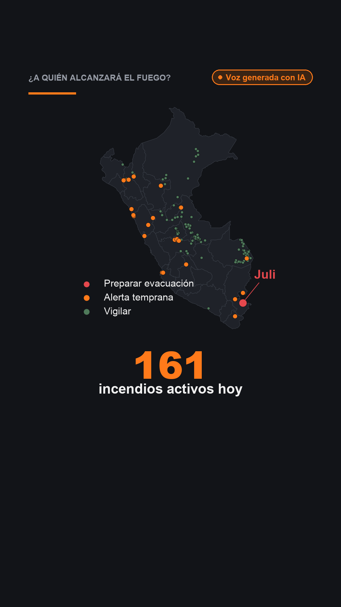

# Del texto a mi voz: reel de «¿A quién alcanzará el fuego?»

Tarea de clase (Ciencia de Datos con Python, sesión 15, 24 oct 2026). Convertí mi tablero de incendios en un **reel de 52 segundos narrado con mi voz clonada**, solo con modelos abiertos.

- **Texto que usé:** el README de [`tarea_data_raster`](../tarea_data_raster/README.md), que tiene las cifras de mi [dashboard de incendios](https://claude.ai/artifact/B6Xd7Qk5C5pGghCu1tjt68) (1 082 palabras).
- **Entrega:** [`salidas/reel.mp4`](salidas/reel.mp4) y [`salidas/posts.md`](salidas/posts.md); además [`salidas/reel.srt`](salidas/reel.srt) y [`salidas/portada.png`](salidas/portada.png).
- **Pipeline en un slide:** https://claude.ai/artifact/Kzp7SSZQBcPUVkc8b7vRSs



## El flujo

| Paso | Qué hace | Herramienta | Dónde corre | Archivo |
|---|---|---|---|---|
| 1. Texto largo | README del tablero de incendios | — | GitHub | `../tarea_data_raster/README.md` |
| 2. Guion | Escenas en JSON: `frase` (se dice), `cifra` y `etiqueta` (se ven) | **Qwen** (v1); Claude (v2) | Navegador | `respuesta_qwen.txt` |
| 3. Revisión | Control automático de cifras (¡¡) + **mi revisión contra la fuente** | `guion.py` + yo | Mi Mac | `guion_v1.json`, `guion_v2.json` |
| 4. Imágenes | 6 mapas hechos con los resultados de mi tablero | matplotlib (`imagenes.py`) | Mi Mac | `salidas/img/` |
| 5. Mi voz | Clona mi voz con 32 s de una grabación del celular | **Qwen3-TTS 1.7B** (bfloat16) | Mi Mac, chip gráfico | `salidas/escena_*.wav` |
| 6. Video | Whisper controla cada escena y da los tiempos de los subtítulos; Pillow y ffmpeg arman el video | **faster-whisper**, Pillow, ffmpeg | Mi Mac, CPU | `salidas/reel.mp4` |

El video es vertical (1080×1920, 30 cuadros por segundo), con volumen normalizado para redes y una etiqueta **«Voz generada con IA» fija arriba durante todo el reel**.

## Qué corregí del guion y por qué

### Versión 1: el guion de Qwen

El control automático pasó: **las 5 cifras de Qwen estaban en el texto**. Pero varias frases decían más de lo que dice mi trabajo:

| Escena | Qwen escribió | Mi texto dice | Corrección |
|---|---|---|---|
| 1 y 2 | «deberían **evacuar**», «Juli **justifica evacuación**» | «prepararse para evacuar», «justifica **preparar** una evacuación» | Exageraba la alerta: el tablero recomienda prepararse, no ordena evacuar |
| 3 | «1 641 personas **en Candarave**» | 1 641 personas en el corredor de **72 h** | Agregué el horizonte: no es toda la población de Candarave |
| 4 | «**El satélite térmico subestima**» | Medido en **un solo caso** (Tahuania) | Lo planteé como caso de estudio |
| 5 | «23 incendios… **con** 56 distritos» | Los 56 distritos son de **todos** los incendios en rojo y ámbar | Separé las dos cifras |
| Posts | «evacuación **inmediata**»; «el viento multiplica **x8** el riesgo» | «Inmediata» no aparece; el círculo fijo **sobreestima en 142 de 150** incendios | Quité «inmediata» y puse los casos reales (×8 Candarave, ×10 Ticapampa) con su contexto |

### Versión 2: enfocada en responder la pregunta

Después de presentar la v1 en clase, reescribí el guion con Claude para que **responda la pregunta del tablero** (*¿qué poblaciones deberían prepararse para evacuar?*) y no explique el método:

- **Quité** el dNBR de Tahuania (mide el área quemada, no responde *a quién* avisar) y casi todas las limitaciones. Solo queda «no reemplaza a INDECI» en el cierre.
- **Agregué** lo que más sirve para avisar: el primer poblado en el camino de Juli (**Suancata Cañi, ~14 h**) y los **56 distritos** en el camino del fuego.
- **No usé** el total de personas en corredores de 72 h (242 685). Casi la mitad viene de Pisco, que es **un solo foco** (probablemente una quema agrícola): sin esa aclaración, la cifra exageraría el riesgo.
- Volví a pasar todas las cifras del guion y de los posts por el control automático.

**Lección:** los números se verifican con código; las afirmaciones las verifica una persona.

## Lo que aprendí en el camino

- **Whisper transcribe mal los números y los nombres propios** («Sentinel dos mide ciento una» → «Centinel 2100, 1»; «Suancata Cañi» → «Suankatakany»). Por eso el control de audio convierte los dígitos a palabras antes de comparar, y los subtítulos usan el texto del guion revisado: Whisper solo da los tiempos.
- **El clon suena más a mí con la transcripción exacta de mi grabación**, no con la de Whisper. Además, la grabación pasa por un filtro de limpieza: quito el ruido, los silencios del inicio y del final, y nivelo el volumen.
- **El modelo 1.7B en float32 no entra en 16 GB de RAM**: la Mac empezó a usar 14 GB de swap y cada escena tardaba ~3 min. En **bfloat16** ocupa la mitad y tarda menos de un minuto por escena.

## Cómo correrlo

```bash
cd tarea_texto_voz
uv venv .venv --python 3.12
uv pip install --python .venv/bin/python qwen-tts faster-whisper pillow imageio-ffmpeg soundfile jiwer num2words pypdf matplotlib pandas
.venv/bin/python guion.py --solo-prompt > prompt.txt          # pegar en chat.qwen.ai
.venv/bin/python guion.py --respuesta respuesta_qwen.txt       # control de cifras → salidas/guion.md
# revisar a mano contra la fuente → guion_v2.json
.venv/bin/python guion.py --respuesta guion_v2.json            # → salidas/guion.json
.venv/bin/python imagenes.py                                    # → salidas/img/
.venv/bin/python hacer_reel.py --voz mi_voz.wav --texto-voz texto_voz.txt \
    --autor "Isabella Albarrán" --fuente "NASA FIRMS, Open-Meteo, WorldPop, INEI"
```

En una Mac con chip M5 (16 GB) la narración y el video tardan unos 3 minutos. **Mis grabaciones de voz no están en el repositorio** (`.gitignore`); `texto_voz.txt` es solo la transcripción del tramo que usé.

**Reglas:** es mi propia voz, el reel y cada post declaran «Voz generada con IA», y nada se publica sin revisar el guion contra la fuente. Es una herramienta académica: no reemplaza a INDECI.

Hecho con Claude Code.
